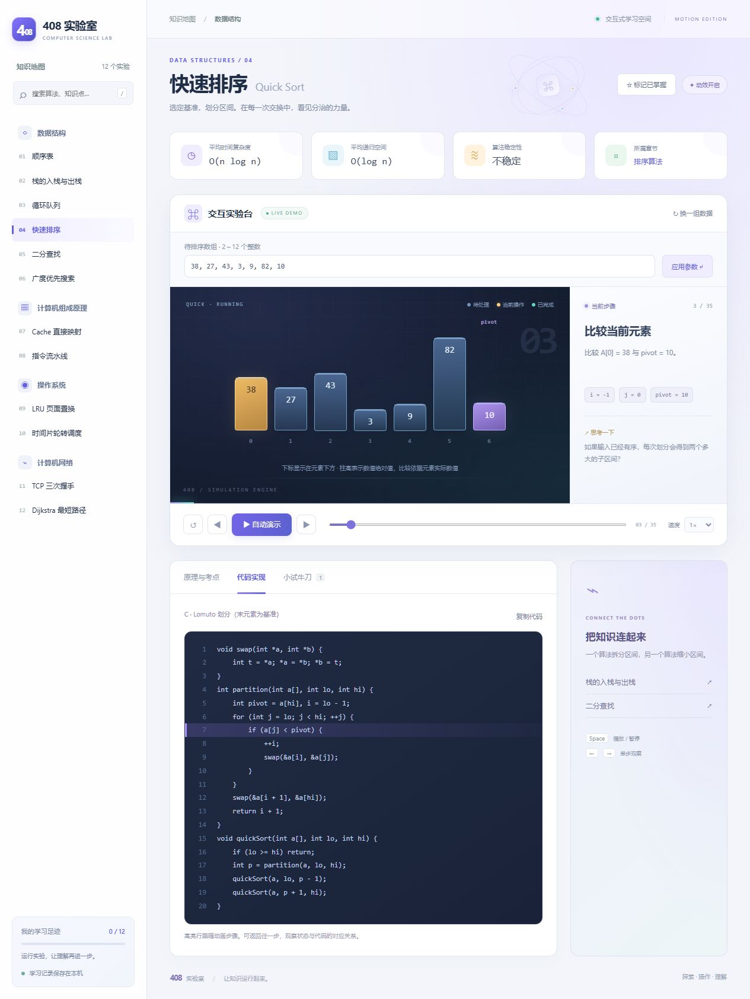

# 408 实验室

一个无需安装依赖、可离线使用的中文计算机 408 可视化学习网站。使用 HTML、CSS 与原生 JavaScript 实现，不依赖 CDN。



## 打开

双击 `dist/index.html` 即可使用。也可在本文件所在目录执行：

```powershell
python -m http.server 4080 --directory dist
```

然后在浏览器打开 http://localhost:4080 。

## 功能

- 12 个实验：顺序表插入 / 删除、栈、循环队列、快速排序、二分查找、BFS、直接映射 Cache、理想五级流水线、LRU、时间片轮转、TCP 三次握手、Dijkstra。
- 自定义输入、随机示例、自动播放、单步前后、时间轴定位与播放速度。
- 逐步说明、变量状态、原理与考点、C 代码或明确标注的伪代码、代码行跟踪、小测验。
- 搜索、知识关联、响应式布局、键盘控制与本地掌握记录。
- Motion Edition：深色演示舞台与多色状态、沿轨迹交换的排序元素、顺序表移动、栈元素进出、图路径与 TCP 报文传播、流水线阶段过渡。
- 动效时长随播放速度调整；支持关闭动效，并遵循系统的“减少动态效果”设置。

## 使用说明

修改参数后点击“应用参数”，动画会重新从第一步开始。点击“代码实现”查看随步骤高亮的代码。空格播放 / 暂停，方向键前后单步，`/` 搜索。焦点处于输入控件或按钮时，不拦截其原生按键操作。

这是一版覆盖四科代表性内容的学习实验集，不是完整的 408 大纲。各模块都标注了实验假设与限制。快速排序采用末元素为基准的 Lomuto 分区；流水线为无冒险理想模型；轮转调度假设进程在零时刻全部到达。

## 文件

- `dist/index.html`：页面结构与入口。
- `dist/style.css`：桌面和移动端样式。
- `dist/lessons.js`：课程内容、输入配置、C 代码、测验。
- `dist/engine.js`：纯函数算法状态生成器，每一步保存独立快照。
- `dist/app.js`：交互、SVG 与 HTML 可视化、播放和本地记录。
- `dist/motion.js`：基于元素身份和位置快照的过渡、传播与完成反馈。
- `dist/visual.css`：Motion Edition 配色、演示舞台、响应式布局与装饰动效。

所有计算在浏览器本地完成，不发送输入数据。掌握记录保存在 localStorage；文件方式打开时，记录是否持久化取决于浏览器对 file:// 的实现。

## 扩展知识点

在 `LESSONS` 中添加元数据，再为 `buildSteps` 增加状态生成逻辑。每一步提供标题、解释、变量和对应代码行；新增可视化类型时在 `draw` 中添加渲染器。

## 验证

安装 Node.js 18 或更高版本后运行（不需要 npm install）：

```sh
node tests/verify.cjs
```

测试覆盖全部 12 个实验、304 组快速排序输入、重复值的动画身份追踪、顺序表插入删除位置、图最短路径的独立参照结果及非法输入，共 625 项检查。

## 发布为静态网站

将完整的 `dist/` 目录作为网站根目录部署即可，不需要构建步骤或服务器端运行时。同目录的四个 JavaScript 文件和两个 CSS 文件都需要保留。
